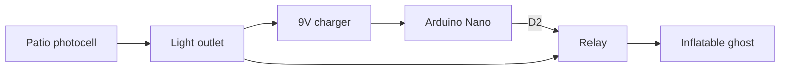

One night I stayed up for a while thinking about things I want to make, and one of them was a timer for the inflatable ghost we put up at home for Halloween. I didn't want to leave it on all night or have to go out and turn it off.

I finished it this weekend and it's already installed.

## The idea

The house already has a photocell that turns on the patio lights when it gets dark. So I thought: if I plug the circuit into that same outlet, it turns on by itself when the lights do. All the circuit has to do is turn the inflatable on and switch it off after 4 hours.

No clock and no schedule to set. The photocell decides when it starts, and the circuit just counts the time.



## Change of plans

At first I was going to use a PIC16F84A, but I didn't have time to make the board. So I built it with what I already had: an Arduino Nano and a ready-made relay board (mine says HW-482).

Sometimes the best way to finish is to use what's already at hand.

## Wiring

- 9V charger: **+** to **VIN** and **−** to **GND** on the Nano.
- Relay: **VCC** to **5V**, **GND** to **GND** and **IN** to **D2**.
- The relay switches the inflatable's outlet.

The Nano and the relay draw about 120 mA. The Nano's regulator gets a little warm, but it handles the 4 hours fine.

## The code

It's very short. When it powers on it turns the relay on, and after 4 hours it turns it off. This is the idea, simplified:

```cpp
const int RELAY_PIN = 2;
const unsigned long ON_TIME_MS = 4UL * 60UL * 60UL * 1000UL; // 4 hours

void setup() {
  pinMode(RELAY_PIN, OUTPUT);
  pinMode(LED_BUILTIN, OUTPUT);
  digitalWrite(RELAY_PIN, HIGH);   // ghost on
  digitalWrite(LED_BUILTIN, HIGH); // indicator
}

void loop() {
  if (millis() >= ON_TIME_MS) {
    digitalWrite(RELAY_PIN, LOW);   // ghost off
    digitalWrite(LED_BUILTIN, LOW);
  }
}
```

To test it I changed the time to `5000UL`, 5 seconds, so I didn't have to wait 4 hours to see if it worked.

## What gave me trouble

- **Uploading the code.** My Nano is a clone with a CH340 chip, and I got the error `not in sync: resp=0x00`. The fix was choosing **Tools → Processor → ATmega328P (Old Bootloader)** in the Arduino IDE. After that it uploaded on the first try.
- **The port.** It shows up as `/dev/ttyUSB0`. When I got `unable to open port`, I reconnected the Nano or stopped ModemManager with `sudo systemctl stop ModemManager`.
- **Power.** Before plugging in the charger I measured its polarity and its no-load voltage, because VIN has no reverse-polarity protection and some chargers put out more than they say. I also never connect USB and the charger at the same time: to reprogram, I unplug the charger first.

:::caution[Careful]
The relay switches the 127 V from the outlet. If you build something similar, always work with everything unplugged and insulate the connections well.
:::

## How it turned out

It's installed and working. It turns on with the patio lights, roughly from 6:30 to 10:30 p.m. if it gets dark early, or from 7 to 11. By 11 there's nobody on the street, so that's a good time for it to turn off.

Tonight is its first night. Tomorrow morning I'll check that it turned itself off.

I'm happy because I finished a weekend project. It also made me realize I need an electronics corner at home, so I can build these prototypes faster.
