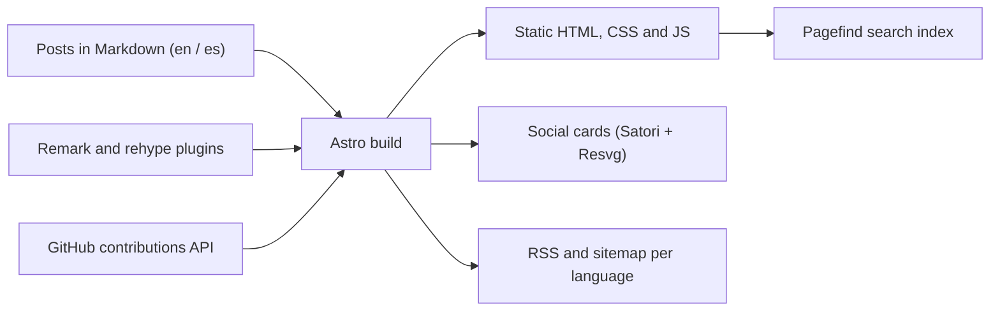
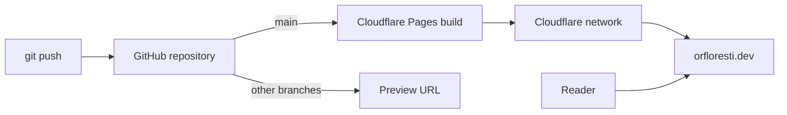

This blog is a static site. There is no server and no database: every page is built once, ahead of time, and then served as plain files. That keeps it fast, simple and free to host. This post is also my own documentation of how it works.

## The stack

- **Astro.** The framework that turns Markdown into HTML. I started from the [MultiTerm](https://github.com/stelcodes/multiterm-astro) template and adapted it.
- **Markdown and MDX.** Each post is a file in the repo. The English version lives in `posts/en/` and the Spanish one in `posts/es/`, with the same file name.
- **Remark and rehype plugins.** They run during the build and add things to the Markdown: reading time, an automatic description, notes and warnings, GitHub cards, math with KaTeX, emoji and diagrams with Mermaid.
- **Tailwind CSS.** For the styles, with JetBrains Mono as the font.
- **Expressive Code.** For the code blocks, using the same themes the reader can pick for the whole site.
- **Pagefind.** The search. It builds an index after the site is generated, and the search runs in the browser.
- **Satori and Resvg.** They generate the preview image you see when a post is shared on social media.

## How a page gets built

Everything happens at build time. Astro reads the posts, runs them through the plugins and writes static files. The GitHub activity calendar on the home page is fetched during the build too.

Only a few things run in the browser: the theme picker, the search and the Mermaid diagrams like the one above.

## Two languages

English lives at the root (`/`) and Spanish under `/es`. A post and its translation share the same file name, which is how the language switcher and the `hreflang` links find each other. Each language has its own RSS feed, and the sitemap lists both versions of each page.

## How it is deployed

The site is hosted on Cloudflare Pages, and the domain is also on Cloudflare. When I push to the repository, Cloudflare runs the build and publishes the result on its network.

Pushing to `main` updates the live site. Pushing to any other branch gives me a preview URL, so I can check a change before publishing it.

## What it costs

Hosting costs nothing. I use Cloudflare Pages' free plan, which is enough for a static blog, and since there is no server or database, there is nothing else to pay for.

## Why this setup

- **Simple.** Writing a post is creating a Markdown file and pushing it.
- **Fast.** Readers get static files from a network close to them.
- **Safe.** With no server or database, there is very little to attack or keep updated.
- **Free.** I can keep the blog running without thinking about a monthly bill.
