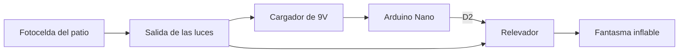

Una noche me quedé despierto un rato pensando en cosas que quiero hacer, y una de ellas fue un timer para el fantasma inflable que ponemos en la casa por Halloween. No quería dejarlo prendido toda la noche ni tener que salir a apagarlo.

Lo terminé este fin de semana y ya está instalado.

## La idea

La casa ya tiene una fotocelda que prende las luces del patio cuando oscurece. Así que pensé: si conecto el circuito a esa misma salida, se prende solo cuando se prenden las luces. Lo único que tiene que hacer el circuito es encender el inflable y apagarlo a las 4 horas.

No necesito reloj ni configurar horarios. La fotocelda decide cuándo empieza y el circuito solo cuenta el tiempo.



## El cambio de plan

Al principio lo iba a hacer con un PIC16F84A, pero no me daba tiempo de hacer la placa. Así que lo armé con lo que ya tenía: un Arduino Nano y una placa de relevador ya hecha (la mía trae la leyenda HW-482).

A veces lo mejor es usar lo que ya está a la mano para terminar.

## Conexiones

- Cargador de 9V: **+** a **VIN** y **−** a **GND** del Nano.
- Relevador: **VCC** a **5V**, **GND** a **GND** e **IN** a **D2**.
- El relevador conmuta el contacto del inflable.

El Nano y el relevador consumen unos 120 mA. El regulador del Nano se calienta un poco, pero aguanta bien las 4 horas.

## El código

Es muy corto. Al encender prende el relevador y, cuando pasan 4 horas, lo apaga. Esta es la idea, simplificada:

```cpp
const int RELAY_PIN = 2;
const unsigned long ON_TIME_MS = 4UL * 60UL * 60UL * 1000UL; // 4 horas

void setup() {
  pinMode(RELAY_PIN, OUTPUT);
  pinMode(LED_BUILTIN, OUTPUT);
  digitalWrite(RELAY_PIN, HIGH);   // prende el fantasma
  digitalWrite(LED_BUILTIN, HIGH); // testigo
}

void loop() {
  if (millis() >= ON_TIME_MS) {
    digitalWrite(RELAY_PIN, LOW);   // lo apaga
    digitalWrite(LED_BUILTIN, LOW);
  }
}
```

Para probar cambié el tiempo a `5000UL`, o sea 5 segundos, y así no tenía que esperar 4 horas para ver si funcionaba.

## Lo que me costó

- **Subir el código.** Mi Nano es clon, con chip CH340, y me salía el error `not in sync: resp=0x00`. La solución fue elegir en el Arduino IDE **Tools → Processor → ATmega328P (Old Bootloader)**. Con eso subió a la primera.
- **El puerto.** Aparece como `/dev/ttyUSB0`. Cuando marcaba `unable to open port`, reconectaba el Nano o detenía ModemManager con `sudo systemctl stop ModemManager`.
- **La alimentación.** Antes de conectar el cargador medí la polaridad y el voltaje sin carga, porque VIN no tiene protección contra polaridad invertida y algunos cargadores dan más voltaje del que dicen. Tampoco conecto el USB y el cargador al mismo tiempo: para reprogramar, primero quito el cargador.

:::caution[Cuidado]
El relevador conmuta los 127 V del contacto. Si haces algo parecido, trabaja siempre con todo desconectado y aísla bien las conexiones.
:::

## Cómo quedó

Ya está instalado y funcionando. Se prende con las luces del patio, más o menos de 6:30 a 10:30 de la noche si oscurece pronto, o de 7 a 11. A las 11 ya no hay gente en la calle, así que está bien que se apague a esa hora.

Hoy es su primera noche. Mañana temprano reviso que se haya apagado solo.

Estoy contento porque terminé un proyecto de fin de semana. Me di cuenta de que necesito un área para electrónica en la casa, así podría hacer estos prototipos más rápido.
