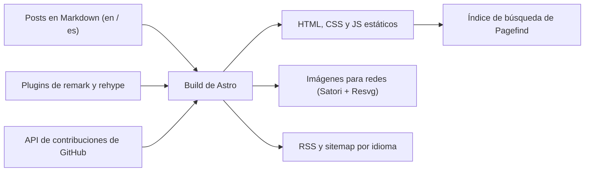
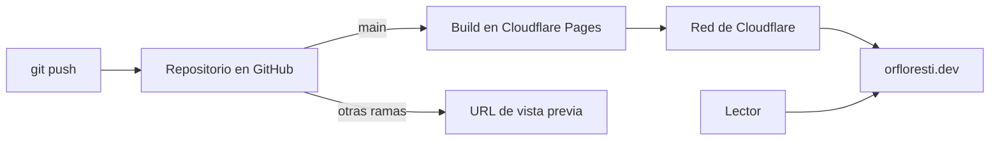

Este blog es un sitio estático. No tiene servidor ni base de datos: cada página se genera una sola vez, antes de publicarse, y después se sirve como archivos normales. Eso lo hace rápido, sencillo y gratis de hospedar. Este post también es mi propia documentación de cómo funciona.

## La tecnología

- **Astro.** El framework que convierte Markdown en HTML. Partí de la plantilla [MultiTerm](https://github.com/stelcodes/multiterm-astro) y la adapté.
- **Markdown y MDX.** Cada post es un archivo en el repositorio. La versión en inglés vive en `posts/en/` y la de español en `posts/es/`, con el mismo nombre de archivo.
- **Plugins de remark y rehype.** Corren durante el build y le agregan cosas al Markdown: tiempo de lectura, descripción automática, notas y advertencias, tarjetas de GitHub, matemáticas con KaTeX, emojis y diagramas con Mermaid.
- **Tailwind CSS.** Para los estilos, con JetBrains Mono como fuente.
- **Expressive Code.** Para los bloques de código, con los mismos temas que el lector puede elegir para todo el sitio.
- **Pagefind.** La búsqueda. Crea un índice después de generar el sitio, y la búsqueda corre en el navegador.
- **Satori y Resvg.** Generan la imagen de vista previa que aparece cuando se comparte un post en redes sociales.

## Cómo se construye una página

Todo pasa en el build. Astro lee los posts, los pasa por los plugins y escribe archivos estáticos. El calendario de actividad de GitHub de la página de inicio también se descarga durante el build.

En el navegador solo corren algunas cosas: el selector de tema, la búsqueda y los diagramas de Mermaid como el de arriba.

## Dos idiomas

El inglés vive en la raíz (`/`) y el español en `/es`. Un post y su traducción tienen el mismo nombre de archivo; así es como el selector de idioma y los enlaces `hreflang` se encuentran entre sí. Cada idioma tiene su propio RSS, y el sitemap incluye las dos versiones de cada página.

## Cómo se despliega

El sitio está hospedado en Cloudflare Pages, y el dominio también está en Cloudflare. Cuando hago push al repositorio, Cloudflare corre el build y publica el resultado en su red.

Un push a `main` actualiza el sitio en vivo. Un push a cualquier otra rama me da una URL de vista previa, así puedo revisar un cambio antes de publicarlo.

## Cuánto cuesta

Hospedarlo no cuesta nada. Uso el plan gratuito de Cloudflare Pages, que alcanza para un blog estático, y como no hay servidor ni base de datos, no hay nada más que pagar.

## Por qué así

- **Sencillo.** Escribir un post es crear un archivo Markdown y hacer push.
- **Rápido.** Los lectores reciben archivos estáticos desde una red cercana a ellos.
- **Seguro.** Sin servidor ni base de datos, hay muy poco que atacar o mantener actualizado.
- **Gratis.** Puedo mantener el blog sin pensar en una factura mensual.
